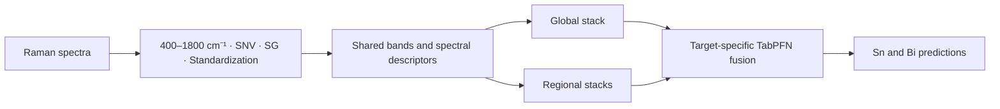

# RaChor

**Raman Chorus (RaChor)** connects Raman fingerprints with paired Sn and Bi responses through shared spectral representation and global–regional hierarchical stacking. It combines selected Raman channels, spectral-shape descriptors, and complementary regression models, then uses target-specific TabPFN meta-learners to produce the final predictions.

RaChor organizes prediction into four connected components:

- **Spectral preprocessing:** retain the 400–1800 cm⁻¹ fingerprint interval, apply standard normal variate (SNV) normalization and a Savitzky–Golay first derivative, and standardize the spectral channels.
- **Shared representation:** identify a common candidate-band pool for Sn and Bi using MultiTaskLassoCV, apply target-specific feature limits, and add spectral center, width, intensity sum, and four cosine positional descriptors.
- **Global and regional prediction:** combine PLS, KRR, ElasticNet, random Fourier feature ridge regression, and random-subspace ridge models globally; construct regional stacks over the low-, middle-, and high-frequency intervals.
- **Target-specific fusion:** use separate TabPFN meta-learners to combine the global prediction with retained regional predictions for each metal.



## Script architecture

```text
RaChor/
├── main.py                         # Cross-validation and full-data model export
├── config.py                       # Folds, seeds, feature limits, regional settings
├── requirements.txt                # All training, baseline, and plotting dependencies
├── export_deployment_artifacts.py   # Export complete prediction bundles
├── data/
│   ├── Raman_spectroscopy_data.xlsx
│   └── Raman_spectroscopy_data_preprocessed.csv
├── data_preprocessing/
│   └── spectral_preprocessing.py
├── features/
│   ├── selector.py
│   └── builder.py
├── models/
│   ├── custom_models.py
│   └── trainer.py
├── pipeline/
│   ├── orchestrator.py
│   └── reporter.py
├── utils/
├── nestedcv_oof_predictions.xlsx    # Saved RaChor evaluation results
├── other_models/
│   ├── rf_bayesian_oof.py
│   ├── xgb_bayesian_oof.py
│   ├── catboost_bayesian_oof.py
│   ├── cnn_bayesian_oof.py
│   ├── cnn_baseline.py
│   ├── baseline_workflow.py
│   ├── plot_baseline_comparison.py
│   ├── plotting_helpers/           # Local styles and figure QA tools
│   └── results/                    # Independent baseline outputs
└── te_not_in_training_comparison/  # Recorded supplementary-sample checks
```

Directories such as `artifacts/`, `other_models/figures/`, and `other_models/plot_data/` are created when their corresponding commands run.

## Core tasks

### Train and evaluate RaChor

The training workflow reads paired metal labels and numeric Raman columns, builds fold-specific representations, tunes the regression models, and reports outer-fold predictions. The default configuration uses five outer folds and five inner folds with a base random seed of 42.

### Export a complete prediction model

The exporter refits the model on the available training data and saves its global models, regional models, final fusion layers, spectral metadata, and fitted preprocessing scaler. These artifacts are separate from models fitted during cross-validation.

### Compare independent full-spectrum models

RF, XGBoost, CatBoost, and a one-dimensional CNN each have an independent entry point. They use the full 400–1800 cm⁻¹ spectrum after SNV, SG first-derivative processing, and training-partition standardization. Each baseline uses an outer OOF evaluation and Bayesian hyperparameter optimization within the outer training partition, with **20 initial evaluations + 40 optimization iterations** by default.

### Inspect predictions and plot comparisons

Saved sample-level OOF predictions, fold metrics, and optimization histories support numerical comparison and plotting. The plotting script follows the manuscript's Figure 3 conventions: fold-marked box plots, measured-versus-predicted scatter plots, identity lines, fitted lines, and OOF metric annotations.

## Quick start

Use a Python environment compatible with the pinned packages; Python 3.11 is a suitable starting point. GitHub access is required to clone this private repository.

```bash
git clone https://github.com/lzhzzzzwill/RaChor.git
cd RaChor

python -m venv .venv
source .venv/bin/activate
python -m pip install -r requirements.txt

# Generate the preprocessed spectral table.
python data_preprocessing/spectral_preprocessing.py

# Cross-validation followed by a full-data model fit and export.
python main.py
```

On Windows, activate the environment with `.venv\Scripts\activate`. TabPFN pretrained checkpoints are obtained through the installed TabPFN package and are not bundled as weights in this repository. If TabPFN is unavailable, the existing factory falls back to Ridge and logs a warning; such runs should be identified separately.

For cross-validation only:

```bash
python main.py --skip-model-export
```

To export the full-data model separately:

```bash
python export_deployment_artifacts.py --artifact-dir artifacts
```

## Run the independent baselines

After installing the same `requirements.txt`, launch the models separately:

```bash
python other_models/rf_bayesian_oof.py
python other_models/xgb_bayesian_oof.py
python other_models/catboost_bayesian_oof.py
python other_models/cnn_bayesian_oof.py
```

Results are written to `other_models/results/`, with a separate directory for each model. Repeated runs receive timestamp suffixes. CNN uses 150 epochs per fit by default; `--epochs` controls CNN training, while `--init-points` and `--n-iter` control Bayesian search.

```bash
python other_models/cnn_bayesian_oof.py --epochs 200
```

After the required models finish, generate the comparison figures:

```bash
python other_models/plot_baseline_comparison.py
```

The script checks sample identifiers, observed labels, and fold assignments before comparing runs. It reads the latest completed run for each model, includes RaChor final fusion by default, and writes figures to `other_models/figures/` and plotting source data to `other_models/plot_data/`. Use `--models RF XGBoost --no-rachor` to plot a subset. See [the baseline guide](other_models/README.md) and [the XGBoost guide](other_models/XGB_BAYESIAN.md) for more options.

## Data and outputs

The default training table contains 187 samples. The response columns are `118Sn (KED)` and `209Bi (KED)`; spectral columns are recognized by numeric headers within 400–1800 cm⁻¹. Responses retain the numeric scale supplied in the dataset. Other metal-label columns are not used as spectral inputs.

RaChor writes `nestedcv_oof_predictions.xlsx`, including global-stack and final-fusion predictions, fold performance, and a global summary. Historical code and workbook identifiers use `MoE` for final fusion; the implemented method is hierarchical stacking with TabPFN meta-learners.

Baseline outputs include `Sn_oof_predictions.csv`, `Bi_oof_predictions.csv`, `oof_predictions.csv`, `fold_performance.csv`, `global_summary.csv`, optimization histories, and an Excel summary. Metrics are **R², RMSE, and RPD**, with MAE additionally retained for independent baselines. RPD is the sample standard deviation (`ddof=1`) divided by RMSE. Pooled OOF metrics are calculated from all outer holdout predictions, not by averaging fold scores.

The existing RaChor workflow standardizes the full spectral dataset before outer cross-validation and performs supervised band selection before internal stacking OOF generation. Independent baselines fit StandardScaler inside each training partition. These conventions are recorded separately; sample-level OOF results evaluate the supplied material collection rather than transfer to a new experimental batch or instrument. Recorded supplementary-sample checks are described in [their data notes](te_not_in_training_comparison/README.md).

## Paths and repository scope

Training paths are relative to their scripts. Baseline file arguments are relative to `other_models/`; plotting arguments are relative to the RaChor root. The default model export directory is `artifacts/`, and the default model cache is `.cache/tabpfn/`.

This repository contains the local RaChor code directory, including its data and recorded outputs. The manuscript, standalone web application, and other project directories are outside this repository. Caches, Python bytecode, editor settings, and credentials are excluded from version control.
